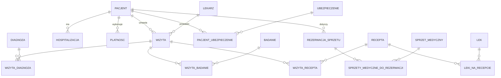

# 🏥 Hospital Schema

Relacyjny model bazy danych szpitala dla **PostgreSQL**. Projekt obejmuje pełny skrypt SQL, który tworzy schemat `szpital` wraz z tabelami, kluczami głównymi i obcymi oraz indeksami. Model pokrywa podstawowe procesy szpitalne: rejestrację pacjentów, wizyty lekarskie, diagnozy, badania, recepty, hospitalizacje, płatności, ubezpieczenia oraz rezerwację sprzętu medycznego.


## Spis treści

- [Zakres modelu](#zakres-modelu)
- [Diagram ER](#diagram-er)
- [Opis tabel](#opis-tabel)
- [Wymagania](#wymagania)
- [Instalacja i uruchomienie](#instalacja-i-uruchomienie)
- [Struktura repozytorium](#struktura-repozytorium)
- [Kluczowe rozwiązania projektowe](#kluczowe-rozwiązania-projektowe)
- [Dalszy rozwój](#dalszy-rozwój)
- [Autor](#autor)

## Zakres modelu

Baza obsługuje następujące obszary:

| Obszar | Co obejmuje |
|---|---|
| Pacjenci | dane osobowe i kontaktowe, PESEL, powiązanie z ubezpieczeniem |
| Personel | lekarze identyfikowani numerem PWZ, specjalizacja, licencja |
| Wizyty | termin, godzina, rodzaj wizyty, lekarz, pacjent |
| Medycyna | diagnozy (kody ICD), badania i ich wyniki, recepty i leki |
| Hospitalizacje | oddział, łóżko, daty przyjęcia i wypisu |
| Finanse | płatności pacjentów, ubezpieczenia |
| Zasoby | sprzęt medyczny i jego rezerwacje w przedziałach czasowych |

## Diagram ER



## Opis tabel

Schemat `szpital` zawiera **18 tabel**.

**Tabele główne**

| Tabela | Klucz główny | Opis |
|---|---|---|
| `pacjent` | `id_pacjenta` | Dane pacjenta; `pesel` jest unikalny |
| `lekarz` | `numer_pwz` | Dane lekarza i specjalizacja |
| `wizyta` | `(data_wizyty, numer_pwz, id_pacjenta)` | Wizyta pacjenta u lekarza |
| `hospitalizacja` | `(id_hospitalizacji, id_pacjenta)` | Pobyt na oddziale |
| `platnosc` | `id_platnosci` | Płatność z kwotą i typem |
| `ubezpieczenie` | `id_ubezpieczenia` | Nazwa, typ i zakres ubezpieczenia |
| `diagnoza` | `id_diagnoza` | Diagnoza z kodem ICD |
| `badanie` | `id_badanie` | Słownik typów badań |
| `recepta` | `id_recepta` | Recepta z datą wystawienia i zaleceniami |
| `lek` | `id_lek` | Słownik leków |
| `sprzet_medyczny` | `id_sprzetu` | Sprzęt wraz z dostępnością |
| `rezerwacja_sprzetu` | `id_rezerwacji` | Nagłówek rezerwacji sprzętu |

**Tabele łączące (relacje wiele-do-wielu)**

| Tabela | Łączy |
|---|---|
| `pacjent_ubezpieczenie` | pacjentów i ubezpieczenia |
| `wizyta_diagnoza` | wizyty i diagnozy (z opisem) |
| `wizyta_badanie` | wizyty i badania (z wynikiem) |
| `wizyta_recepta` | wizyty i recepty |
| `leki_na_recepcie` | recepty i leki |
| `sprzety_medyczne_do_rezerwacji` | rezerwacje i sprzęt (z zakresem dat i godzin) |

## Wymagania

- PostgreSQL 12 lub nowszy
- Uprawnienia do tworzenia schematów i rozszerzeń w docelowej bazie
- Rozszerzenie `btree_gist` (potrzebne dla ograniczenia wykluczającego na hospitalizacjach)

## Instalacja i uruchomienie

> ⚠️ **Uwaga:** skrypt na początku usuwa istniejący schemat `szpital` (`DROP SCHEMA IF EXISTS`). Nie uruchamiaj go na bazie z danymi, których nie chcesz stracić.

1. Sklonuj repozytorium:

   ```bash
   git clone https://github.com/Drwalpawel20/hospital_schema.git
   cd hospital_schema
   ```

2. Utwórz bazę danych i włącz wymagane rozszerzenie:

   ```bash
   createdb szpital_db
   psql -d szpital_db -c "CREATE EXTENSION IF NOT EXISTS btree_gist;"
   ```

3. Załaduj schemat:

   ```bash
   psql -d szpital_db -f szpital.sql
   ```

4. Sprawdź, czy tabele zostały utworzone:

   ```sql
   \dt szpital.*
   ```

## Struktura repozytorium

```
hospital_schema/
├── szpital.sql    # pełny skrypt DDL: usuwanie, tworzenie tabel, klucze, indeksy
└── README.md
```

## Kluczowe rozwiązania projektowe

- **Osobny schemat `szpital`** porządkuje obiekty i oddziela je od schematu `public`.
- **Unikalny PESEL** (`UX_pacjent_pesel`) chroni przed duplikatami pacjentów.
- **Ograniczenie wykluczające** `UX_hosp_pacjent_daty` (`EXCLUDE USING gist`) uniemożliwia nakładające się hospitalizacje tego samego pacjenta, bo porównuje zakresy `daterange(data_przyjecia, data_wypisu)`.
- **Złożone klucze główne** w tabeli `wizyta` oraz w tabelach łączących odzwierciedlają zależności między wizytą, lekarzem i pacjentem.
- **Tabele asocjacyjne** rozwiązują relacje wiele-do-wielu (leki na recepcie, diagnozy i badania na wizycie, sprzęt w rezerwacji).
- **Indeksy** na kluczach obcych (`platnosc.id_pacjenta`, `rezerwacja_sprzetu.id_pacjenta`) przyspieszają typowe zapytania.
- **Jawne klucze obce** (`ON DELETE NO ACTION`) pilnują spójności referencyjnej danych.

## Dalszy rozwój

- [ ] Przykładowe dane testowe (`seed.sql`) i typowe zapytania analityczne
- [ ] Automatyczne generowanie identyfikatorów (`GENERATED ... AS IDENTITY`)
- [ ] Przechowywanie haseł wyłącznie w postaci skrótu (hash + sól) lub wyniesienie uwierzytelniania poza bazę
- [ ] Ujednolicenie powiązania pacjent–ubezpieczenie (kolumna `pacjent.id_ubezpieczenia` i tabela `pacjent_ubezpieczenie` częściowo się dublują)
- [ ] Widoki raportowe (np. historia pacjenta, obłożenie oddziałów)
- [ ] Diagram ERD w formie obrazu w katalogu `docs/`

## Autor

**Paweł** – [@Drwalpawel20](https://github.com/Drwalpawel20)

## Licencja

Projekt udostępniony bez określonej licencji. Aby umożliwić innym korzystanie z kodu, dodaj plik `LICENSE` (np. MIT).
